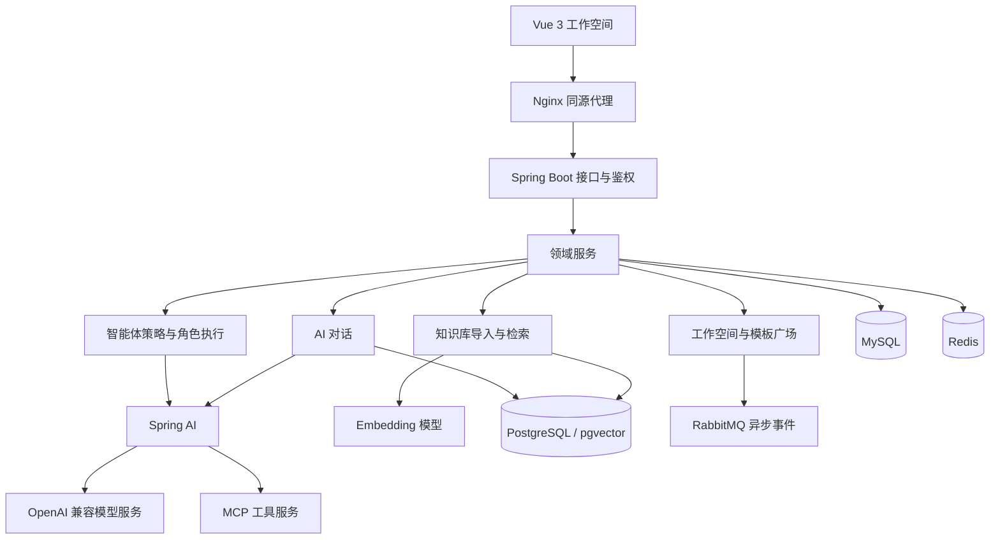

<div align="center">
  
  <h1>ZFlow · 知流</h1>
  <p><strong>让模型、知识与工具，在一个工作空间里协作。</strong></p>
  <p>AI 对话 · 智能体工作流 · RAG 知识库 · MCP 工具</p>
  <p>
    
    
    
    
    
    
  </p>
  <p>
    <a href="#功能一览">功能一览</a> ·
    <a href="#系统架构">系统架构</a> ·
    <a href="#快速开始">快速开始</a> ·
    <a href="#本地开发">本地开发</a> ·
    <a href="#项目文档">项目文档</a>
  </p>
</div>

## 项目介绍

ZFlow 是一个基于 **Spring AI + Vue 3** 的全栈智能体工作空间。它将模型接入、流式对话、多角色任务执行、知识检索和外部工具调用整合在一起，让用户从一次对话开始，逐步建立可配置、可复用的 AI 工作流程。

你可以用它整理资料、拆解任务、查询个人知识库，也可以为智能体连接搜索、天气、邮件等工具。工作台、智能体管理、模板广场和管理中心共用一套前端界面，覆盖从个人使用到配置维护的完整路径。

## 功能一览

| 模块 | 能做什么 |
| --- | --- |
| **工作台** | 从任务输入、快捷入口、智能体卡片和最近会话开始工作 |
| **自由对话** | 选择模型客户端，关联知识库与 MCP 工具，接收 SSE 流式回复，管理历史会话 |
| **智能任务** | 使用 Step、Loop、ReAct 三种策略，查看角色阶段、执行过程和最终答复 |
| **我的智能体** | 创建智能体，编辑职责、模型、角色提示词和工具，管理自己的及复制、收藏的智能体 |
| **知识库** | 上传文件或导入 Git 仓库，通过文本切分、向量化和标签检索为对话补充上下文 |
| **发现广场** | 搜索模板，查看详情，点赞、收藏、评论，并复制到个人工作空间 |
| **定时任务** | 配置六字段 Cron 表达式、执行参数与任务启停状态 |
| **个人设置** | 管理模型服务、MCP 连接、头像、用户名与密码 |
| **管理中心** | 查看统计数据，维护模型、提示词、客户端、智能体、用户和执行流程等资源 |

新版前端采用米白与灰绿配色，提供桌面侧栏、移动端抽屉导航、全局搜索和 Markdown 消息展示。访客可以进入演示工作空间体验界面；登录后使用真实账号数据与服务。

### 三种智能体执行策略

| 策略 | 角色链路 | 适用任务 |
| --- | --- | --- |
| **Step** | 检查 → 规划 → 执行 → 回复 | 可先拆解步骤、再逐项完成的明确任务 |
| **Loop** | 分析 → 执行 → 监督 → 总结 | 需要根据反馈反复修正的任务 |
| **ReAct** | 观察 → 推理 → 行动 → 评估 | 需要结合当前结果逐步决定下一步的任务 |

执行策略通过工厂模式分派，各角色可以配置模型、提示词与工具。后端通过 SSE 输出阶段事件，前端分别呈现过程、完成状态和异常信息。

### 知识检索与工具扩展

**RAG 链路：** 文件 / Git 仓库 → 文本提取与切分 → Embedding → pgvector → 按知识库标签检索 → 补充对话上下文。

**MCP 服务：** 五个独立 Java 服务，可按需要构建和启动。

| 服务 | 能力 | 默认端口 |
| --- | --- | --- |
| `mcp-server-csdn` | 发布文章 | 9001 |
| `mcp-server-wecom` | 发送企业微信文本与卡片消息 | 9002 |
| `mcp-server-amap` | 查询天气 | 9003 |
| `mcp-server-email` | 发送邮件 | 9004 |
| `mcp-server-bocha` | 联网搜索 | 9005 |

工具调用需要配置对应服务的凭据；模型、Embedding 和对象存储也使用各自的服务配置。

## 系统架构



后端采用 DDD 分层组织业务。接口适配、领域逻辑和基础设施实现分别放在独立 Maven 模块中；模型调用、工具装配与任务执行按职责拆分，便于扩展执行策略和服务提供方。

| 层次 | 主要技术 |
| --- | --- |
| 前端 | Vue 3、Vite 7、CSS / SVG、Fetch、SSE、DOMPurify |
| 后端 | Java 17、Spring Boot 3.4、Spring AI 1.0、MyBatis |
| 数据与检索 | MySQL 8、PostgreSQL、pgvector |
| 缓存与异步事件 | Redis、RabbitMQ |
| 鉴权与文件存储 | JWT、阿里云 OSS |
| 部署 | Docker Compose、Nginx、Maven / npm 构建 |

### 工程细节

- **流式协议处理**：支持事件分片、多种换行和 UTF-8 字节分片，区分正常完成、异常与连接中断。
- **长整数精度**：前端解析和序列化 Java Long 标识时保留原始精度，避免更新错位。
- **事务与缓存**：相关缓存失效操作延后至外层数据库事务提交后执行，减少提交前重新读入旧数据的问题。
- **异步业务处理**：通过消息队列处理工作空间事件，配合重试队列和死信队列。
- **接口契约**：前端维护接口清单、字段定义与契约校验，覆盖用户端及管理端的请求结构。

## 项目结构

```text
ZFlow/
├── frontend/
│   ├── app/                     # 当前前端源码
│   │   ├── pages/               # 工作台、对话、智能体、知识库等页面
│   │   ├── components/          # 通用界面组件
│   │   ├── lib/                 # 接口请求、SSE 协议与工作空间状态
│   │   ├── tests/               # 协议与契约测试
│   │   ├── App.vue              # 根组件与 Hash 导航
│   │   └── main.js              # 应用入口
│   ├── public/                  # 品牌与静态资源
│   ├── docs/                    # 前端说明与接口文档
│   ├── scripts/                 # 联调与契约生成脚本
│   ├── src/                     # 保留的历史前端实现
│   └── index.html               # 加载 app/main.js
├── backend/
│   ├── zflow-api/               # 接口契约
│   ├── zflow-app/               # 启动入口与配置
│   ├── zflow-domain/            # 领域模型与业务服务
│   ├── zflow-trigger/           # HTTP、消息监听与定时任务适配
│   ├── zflow-infrastructure/    # 数据访问与基础设施实现
│   ├── zflow-types/             # 公共类型、异常与常量
│   ├── docs/                    # SQL、Docker 与运行文档
│   └── pom.xml                  # Maven 聚合工程
└── mcp/                         # 五个独立 MCP 服务
```

## 快速开始

### 1. 准备环境

完整部署需要 **Docker Engine / Docker Desktop** 和 **Docker Compose v2**。Windows 使用 Linux 容器模式。首次构建需要能够下载基础镜像、Maven 与 npm 依赖。

先克隆项目，再在项目根目录执行后续命令：

```bash
git clone https://github.com/gulizhu803-hash/ZFlow.git
cd ZFlow
```

### 2. 创建配置文件

将 [Docker 环境配置示例](backend/docs/docker/.env.example) 复制为同目录下的 `.env`。已有配置时直接编辑该文件。

```bash
# macOS / Linux / Git Bash
[ -f backend/docs/docker/.env ] || cp backend/docs/docker/.env.example backend/docs/docker/.env
```

```powershell
# Windows PowerShell
if (!(Test-Path backend/docs/docker/.env)) {
    Copy-Item backend/docs/docker/.env.example backend/docs/docker/.env
}
```

设置自己的 `PASSWORD` 和 `JWT_SECRET`，按需修改 `WEB_PORT` 与中间件端口。其余字段含义见示例文件中的注释。

### 3. 构建并启动

```bash
docker compose -f backend/docs/docker/docker-compose.yml config --quiet
docker compose -f backend/docs/docker/docker-compose.yml up -d --build --wait --wait-timeout 300 frontend
docker compose -f backend/docs/docker/docker-compose.yml ps
```

启动成功后访问 **[http://localhost:18080](http://localhost:18080)**，入口会自动跳转到工作空间。默认启动前端、后端、MySQL、PostgreSQL / pgvector、Redis 和 RabbitMQ；新数据卷会执行数据库初始化脚本。

未登录时可以浏览演示页面。注册并登录后，在“设置”中添加可用的模型服务，再进入“自由对话”选择客户端开始使用。

### 4. 按需接入服务

| 能力 | 配置位置与要求 |
| --- | --- |
| 普通对话 | 在前端“设置 → 模型服务”填写接口地址、模型名称和 API Key |
| 智能体自动创建 | 在 Docker `.env` 中设置 `SYSTEM_MODEL_BASE_URL`、`SYSTEM_MODEL_API_KEY`、`SYSTEM_MODEL_NAME` |
| 知识库向量化 | 设置 `OPENAI_BASE_URL`、`OPENAI_API_KEY`、`EMBEDDING_MODEL`；当前向量表使用 1024 维，模型输出需匹配 |
| MCP 工具 | 启动所需 MCP 服务，在前端添加连接并配置服务所需凭据 |
| 头像上传 | 设置 `OSS_ENDPOINT`、`OSS_BUCKET`、`OSS_ACCESS_KEY_ID`、`OSS_ACCESS_KEY_SECRET` |

修改后端环境配置后，重新创建后端容器以加载配置：

```bash
docker compose -f backend/docs/docker/docker-compose.yml up -d --no-build --wait backend
```

例如，仅启动邮件 MCP 服务：

```bash
docker compose -f backend/docs/docker/docker-compose.yml --profile mcp up -d --build mcp-server-email
```

更多端口、数据库初始化与构建方式见 [Docker 部署文档](backend/docs/docker/README.md)。

## 本地开发

### 前端

需要 **Node.js 22.12+**。推荐先启动上述 Docker 服务，再通过 Vite 开发前端；示例配置已包含本机代理设置。

```bash
cd frontend
npm ci
```

将 `.env.example` 复制为 `.env.local` 后启动：

```bash
npm run dev -- --host 127.0.0.1 --port 5180 --strictPort
```

打开 Vite 终端输出的本地地址。当前入口为 `index.html → app/main.js → app/App.vue`。

| 命令 | 用途 |
| --- | --- |
| `npm run dev` | 启动开发服务器 |
| `npm run build` | 生成 `dist/` 生产构建 |
| `npm test` | 运行协议与接口契约测试 |
| `npm run contract:studio` | 根据接口文档生成契约清单 |
| `npm run test:live` | 使用配置好的测试账号执行真实服务联调 |

### 后端与 MCP

需要 **JDK 17** 和 **Maven 3.9+**。在项目根目录执行：

```bash
mvn -f backend/pom.xml package -DskipTests=false
```

后端启动类为 `com.zgl.zflow.ZFlowApplication`，构建产物为 `backend/zflow-app/target/zflow-app.jar`。在 IDE 中导入 `backend/pom.xml`，按 [后端环境配置示例](backend/zflow-app/src/main/resources/.env.example) 设置运行环境。

MCP 服务使用各自的 `pom.xml` 独立构建，例如：

```bash
mvn -f mcp/mcp-server-email/pom.xml package -Dmaven.test.skip=true
```

## 验证与使用边界

- 新版前端包含 **11 项协议与契约测试**，覆盖长整数精度、SSE 分片、错误响应和流取消；生产构建已通过。
- 已有真实服务联调记录覆盖登录、流式对话、Step 智能体执行、文件知识库检索、配置维护和部分广场操作，详见 [联调记录](frontend/docs/LIVE-INTEGRATION.md)。
- 演示模式的数据用于界面体验；实际模型回复、向量化和外部工具调用需要有效的服务配置。
- Loop / ReAct 完整执行、Git 仓库导入、定时触发及部分外部工具与管理功能仍需按部署环境继续验证。

## 项目文档

| 文档 | 内容 |
| --- | --- |
| [前端设计与使用](frontend/docs/FRONTEND-REDESIGN.md) | 页面结构、交互、接口处理与演示模式 |
| [API 接入说明](frontend/docs/API.md) | 鉴权、请求约定与调用示例 |
| [接口清单](frontend/docs/API-ENDPOINTS.md) | 用户端与管理端接口 |
| [字段与结构](frontend/docs/API-SCHEMAS.md) | 请求及响应数据结构 |
| [MySQL 数据设计](backend/docs/mysql/README.md) | 业务库表与初始化脚本 |
| [Docker 部署](backend/docs/docker/README.md) | 服务配置、端口与运行方式 |

## License

许可条款见 [LICENSE](LICENSE)。
