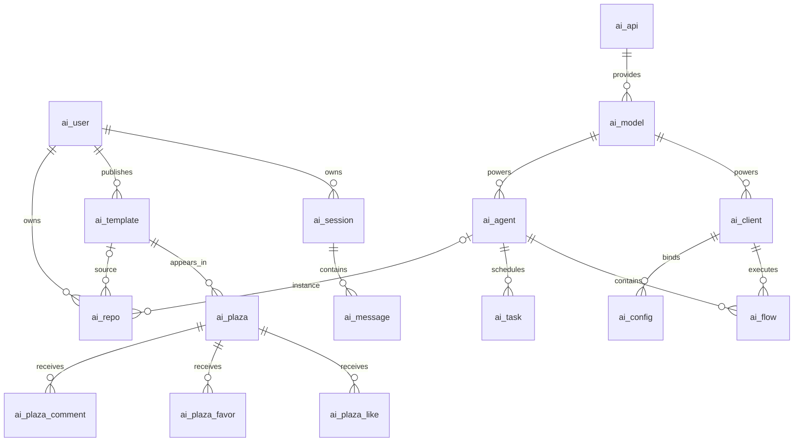

# ZFlow 库表设计

本目录依据当前 Java PO、MyBatis Mapper 和 Repository 的实际读写补建 MySQL 8.0 业务库，不是作者原始数据库的导出。字段长度、默认值和索引是本次设计选择；表名、列名和关联字段与现有代码对齐。

原仓库唯一的 SQL 是 `../docker/conf/table.sql`，它只创建 PostgreSQL 的 `public.vector_store_openai`；README 中提及的 MySQL 脚本目录原先缺失。

## 初始化文件

| 文件 | 用途 |
| --- | --- |
| [01-schema.sql](01-schema.sql) | 创建 `ai-agent` 数据库及 20 张业务表，包含字段注释、主键、唯一键、查询索引 |
| [02-seed.sql](02-seed.sql) | 补入 `advisor_work_memory`，不覆盖已有配置 |
| [../docker/conf/table.sql](../docker/conf/table.sql) | 既有 PostgreSQL 向量表，包含 vector/pgcrypto 扩展和 1024 维向量列 |

SQL 使用 `CREATE ... IF NOT EXISTS`，不会删除现有数据，但也不会修改已存在表的结构。旧库升级需要单独审查差异并编写迁移，不能把重复导入当作迁移。

## 表清单

所有表都有 `BIGINT` 自增主键 `id`、`create_time` 和自动更新的 `update_time`。业务 ID 使用 `VARCHAR(128)` 并区分大小写，兼容代码生成的混合大小写随机 ID。展示名称默认使用 `utf8mb4_0900_ai_ci`。

| 表 | 作用 | 主要关联 / 唯一性 |
| --- | --- | --- |
| `ai_user` | 用户、角色、密码哈希、头像、状态 | 用户名唯一；其他用户字段引用其数字 `id` |
| `ai_api` | 模型服务地址、密钥、请求路径 | `api_id` 唯一；`api_from` 为所有者 |
| `ai_model` | 模型名称、类型 | `model_id` 唯一；`api_id` 关联 API |
| `ai_advisor` | 记忆 / RAG 顾问参数 | `advisor_id` 唯一 |
| `ai_prompt` | 系统提示词 | `prompt_id` 唯一 |
| `ai_mcp` | 工具连接参数、凭据、超时 | `mcp_id` 唯一 |
| `ai_client` | chat/work 客户端 | `client_id` 唯一；关联模型 |
| `ai_config` | 客户端绑定 prompt/advisor/mcp | `(client_id, config_type, config_value)` 唯一 |
| `ai_agent` | Agent 策略、模型、发布模板 | `agent_id` 唯一；未发布的 `template_id` 可空 |
| `ai_flow` | Agent 角色链和节点提示词 | Agent 内角色和客户端分别唯一 |
| `ai_task` | Cron 调度任务 | `task_id` 唯一；关联 Agent |
| `ai_session` | 用户的 chat/work 会话 | `session_id` 唯一 |
| `ai_message` | 用户消息、助手消息、SSE 输出 | 通过会话、类型、序号检索 |
| `ai_template` | 发布时的完整配置快照 | `template_id` 唯一；归属发布者 |
| `ai_repo` | 自建 / Fork / 收藏仓库条目 | `repo_id`、用户+Agent+类型、用户+模板+类型分别唯一 |
| `ai_plaza` | 模板广场展示及互动计数 | `plaza_id` 唯一；关联模板和发布者 |
| `ai_plaza_like` | 点赞记录 | `(plaza_id, user_id)` 唯一 |
| `ai_plaza_favor` | 收藏记录 | `(plaza_id, user_id)` 唯一 |
| `ai_plaza_comment` | 评论和用户名快照 | `comment_id` 唯一 |
| `ai_stat` | 每日运行统计 | `(stat_date, stat_category, stat_key, stat_value)` 唯一 |

`AiApiModel` 是 `ai_api INNER JOIN ai_model` 的查询结果对象，不对应第 21 张实体表。

## 主要逻辑关系

下图表示业务关联，不代表 SQL 已创建物理外键。

## 与现有代码的兼容决定

- **保留 `systen_prompt`**：PO 和 Mapper 都使用这个拼写，直接改为 `system_prompt` 会导致读写失败。模板的 `api_completion_url` 也保持 Mapper 现有命名。
- **暂不设物理外键**：系统配置所有者用 `0`，并没有对应用户；`ai_config` 的目标表由 `config_type` 决定；当前删除流程还会先删除客户端再删除工作流。关系完整性由应用维护，后续统一调整事务及删除顺序后再考虑外键。
- **可空关联**：未发布的自建 Agent 和仓库条目没有模板；收藏条目没有 Agent。不能将这些列设为非空，也不使用空字符串充当默认业务 ID。
- **唯一键参与业务行为**：点赞和收藏 Mapper 使用 `INSERT IGNORE`，统计 Mapper 使用 `ON DUPLICATE KEY UPDATE`。缺少对应唯一键会重复点赞、收藏或新增统计行。
- **消息序号只加普通索引**：应用使用 `MAX(message_seq)+1` 分配序号，并发调用可能分配相同值；加唯一约束会让当前写入直接报错。并发序号分配需另行改造。
- **参数和快照采用 LONGTEXT**：Java 当前按字符串读写，并允许部分空参数，不施加额外 JSON 校验。消息、提示词也使用 LONGTEXT。
- **任务默认状态与代码一致**：`task_status` 默认为 1，与 `SettingTaskDTO` 一致。MyBatis INSERT 显式传入此列时，实际状态以应用传值为准，SQL 默认值不会替代显式 NULL。
- **默认顾问**：创建及 Fork Agent 固定引用 `advisor_work_memory`；种子类型为代码要求的 `Memory`，本次将 `maxMessages` 初值设为 20，可后续调整。
- **索引按现有查询选择**：所有者、关联 ID、会话消息顺序、广场排序、统计维度均有索引；`LIKE '%关键词%'` 查询不能依靠普通 B-tree 索引消除全表扫描。
- **账号通过应用注册**：不植入默认管理员密码或虚构模型/API 密钥。注册后如需管理员，按 Docker 启动说明对明确的账户设置 `user_role='admin'`。

## PostgreSQL / Redis / RabbitMQ

PostgreSQL 数据库同样名为 `ai-agent`，只负责 RAG。`vector_store_openai` 包含 UUID 主键、文本 `content`、JSONB `metadata` 和 `VECTOR(1024)`；知识库标签存放在 `metadata.knowledge`。后端显式关闭自动建表，必须保留初始化脚本挂载。更换 Embedding 模型时，应确认输出维度与表列及 `EMBEDDING_DIMENSIONS` 一致；旧向量通常需重新生成。

现有向量脚本没有近似向量检索索引；本阶段保留其结构，数据量增长后再依据实际距离度量和查询计划选择 HNSW 等索引。Redis 用于缓存，RabbitMQ 用于工作区异步消息，本阶段不为它们额外设计 MySQL 表。OneAPI 的独立 `oneapi` 库由 OneAPI 自己管理表结构，不计入 20 张业务表。

## 验证范围与后续事项

静态核对覆盖 MyBatis Mapper 的表引用、resultMap 列、Java/SQL 字段类型、INSERT 必填列、关键唯一键、InnoDB 索引长度、任务默认状态和初始化种子。执行方式：在项目根目录运行 `node backend/docs/mysql/validate-schema.mjs`。该检查不是 MySQL SQL 解析器，也不能替代数据库导入及业务联调。

库表设计阶段按要求只做静态检查。随后在用户授权启动后，已在本项目独立 Docker 数据库导入 20 张表，并通过注册登录、会话操作、点赞去重、统计聚合和向量写入检查。实际 Agent 执行及模型调用仍需真实凭据，详见 [启动验证记录](../docker/RUN-VERIFICATION.md)。

复查静态检查已通过：20 张表、171 个 resultMap 映射字段、20 条 INSERT 语句，以及 JOIN 列、类型、必填列、索引长度和关键约束。另使用本机已运行的 phpMyAdmin 内置 SQL Parser 解析建表与种子 SQL，未报告语法错误；仅调用解析器，没有连接或写入数据库。Compose 全部 10 个服务配置解析通过，默认启用 4 个依赖服务；挂载源存在，后端 33 个环境变量在示例中均有定义，宿主机连接端口与 Compose 一致。这些结果不代表 MySQL 引擎导入或完整启动已通过。

检查代码时还发现一个发布链路问题：`WorkspaceRepository.agentPublish` 在首次发布时，给 Agent 设置的 `templateId` 与插入模板时再次随机生成的 ID 不一致。它会造成模板关联不一致，不能靠建表解决；本次仅记录，未改业务逻辑。

复查还发现管理端 Agent 表单和 `AgentManageDTO` 未要求 `modelId` 必填，但 `AdminRepository.toAgentVO` 会直接读取查询到的模型名称。缺失或无效模型可能导致查询失败；当前 DDL 保留模型关联的非空要求，管理端应先选择真实存在的模型，后续需补应用层校验。非空约束也不能阻止空字符串或不存在的模型 ID。

Docker 初始化及后续应用启动步骤见 [Docker 启动说明](../docker/README.md)。
